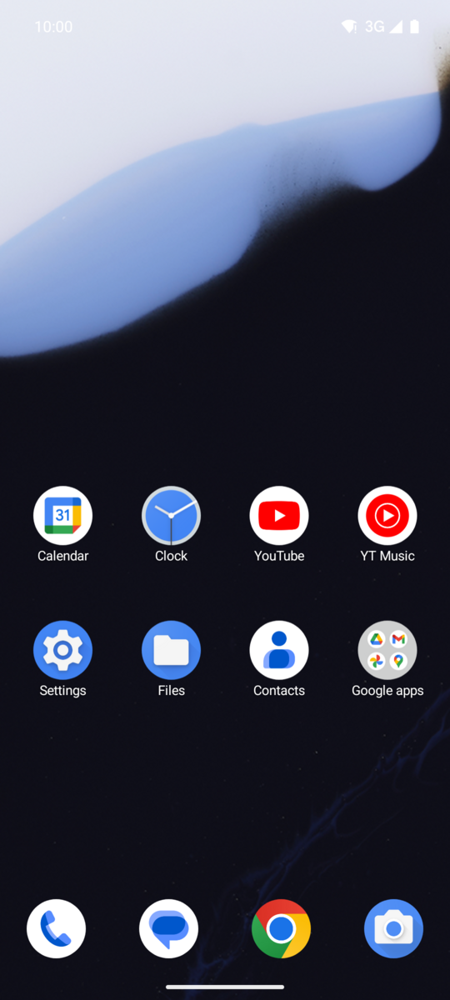
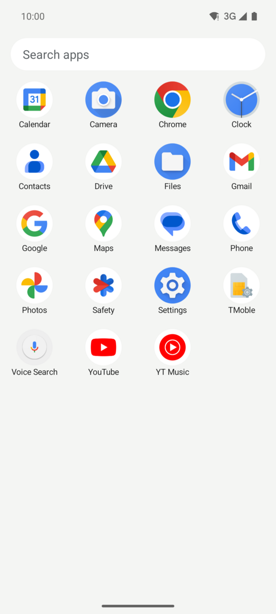
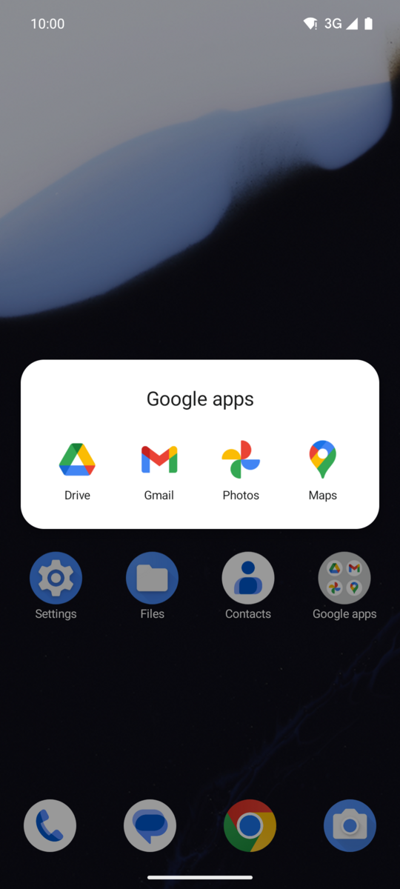

# Corkboard

A home screen launcher for Android that looks and behaves like Pixel Launcher or Lawnchair, with most of their features cut. It is for people who want a plain, fast home screen with folders, widgets, a drawer and real control over icon shapes, and nothing else.

Install an app and it shows up on the home screen and in the app drawer. Drag it around, drop it into a folder, give it the icon shape or custom icon you want, add a widget an app provides. That is the whole product.

- No third-party libraries. Android framework and the Kotlin standard library only. No AndroidX, no Compose.
- No `INTERNET` permission. A launcher has no reason to talk to the network, and leaving the permission out proves it.
- Android 10 (API 29) and newer.

  
  
  

Home screen, app drawer and an open folder, on an Android 15 emulator with the default theme and shape.

## What it does

- Home screen grid with multiple pages and free placement (default 4 x 6, adjustable from 3 to 6 columns and 4 to 8 rows).
- Dock: one row under the pages, same on every page.
- App drawer: swipe up. Alphabetical, search on top, Personal and Work tabs.
- New apps land on the home screen (toggle, on by default). Uninstalled apps disappear everywhere.
- Long-press and drag to rearrange. Items in the way slide aside, Pixel-style. Drag to the screen edge to change page.
- Folders: hold an app over another app for half a second. Rename, reorder, drag out.
- Widgets from installed apps, placed and resized on the grid. Corkboard ships no widgets of its own.
- Pinned shortcuts ("Add to home screen" from Chrome) and app shortcuts in the long-press menu.
- Icon shapes: system default, circle, squircle, rounded square, square, teardrop. Per item: shape, custom image, scale, Fill or Fit treatment, background color.
- Themed icons (Android 13+): each app's monochrome icon tinted to your wallpaper colors, like Pixel Launcher. Off by default.
- Disk icon cache so cold starts skip re-reading every icon. 25 MB by default, adjustable in settings.
- English, Spanish and German.
- Old square icons that Android parks inside a white circle get scaled up to fill the shape instead.
- Work profile: badged icons, Work tab, pause work apps.
- Hide apps, rename labels, lock the layout.
- Themes for the launcher's own surfaces: Follow system, Light, Dark, Verdigris, Kawaii Light, Kawaii Dark.
- Backup and restore of the layout and custom icons to one zip file, plus automatic backups to a folder you pick.
- Haptics, with a master switch and a switch per moment.
- Drag an icon to the top of the screen to Remove it, or Uninstall the app.
- Home screen stays upright unless you allow rotation.
- Swipe down anywhere on the home screen for the notification shade.

Left out on purpose: a Google feed page, notification dots, icon packs, Private space, double-tap to lock.

## Installing

1. Download `Corkboard-vX.Y.Z.apk` from the [Releases](https://github.com/NullAngst/Corkboard/releases) page.
2. Open it on the phone and allow your browser or file manager to install apps if Android asks.
3. Open Corkboard. While it is not the default home app, a card at the top says so. Tap **Set as default**.

App shortcuts, pinned shortcuts and pausing work apps only work once Corkboard is the default home app. Before that, those features hide themselves.

## Using it

On first start the home screen is empty and every app is in the drawer. Everything installed at that point counts as already seen, so it does not spill 150 icons across a dozen pages. Apps installed after that land on the home screen while "Add new apps to home screen" is on.

- **Tap** an app to open it. **Long-press** to lift it. Let go without moving to get its menu.
- **Swipe up** from anywhere above the navigation bar for the drawer (or tap the **Apps** button, if you turned on "Open the drawer with a button"), **swipe down** for notifications, **swipe left or right** for pages. With gesture navigation, a swipe that starts on the very bottom edge belongs to Android and goes to recents instead.
- **Long-press an app in the drawer** and start moving it: the drawer drops away and you place it on the home screen. Let go without moving for its menu.
- **Long-press empty space** for Wallpaper, Widgets and Launcher settings. The widget picker has a search box at the top that matches widget and app names.
- **Home button** while on the home screen closes whatever is open and jumps to page 1.

### Removing and uninstalling by dragging

While you drag an icon, a bar appears at the top of the screen. Drop on **Remove** to take it off the home screen, dock or folder (the app stays in the drawer). Drop on **Uninstall** to open Android's uninstall dialog; the icon goes back where it was until the app is actually gone. Uninstall only shows for apps that can be uninstalled, and Remove doesn't show when dragging out of the drawer. The bar lives in an empty band above the grid (where Pixel puts At a Glance), so it never covers the first row. Where an item lands is decided by where the dragged item is drawn, not by your finger, so a widget grabbed near its top edge goes where it looks like it will.

### Drawer button

Under Drawer, **Open the drawer with a button** adds an **Apps** button to the dock (the middle slot if it's free). It moves like any other icon and can't be removed while the setting is on. With it on, swiping up does nothing; turn the setting off to go back to swiping.

### Haptics

Launcher settings, **Haptics**. **Vibration feedback** turns it all on or off. Under it, each moment has its own switch: opening the app drawer, lifting an icon or opening a menu, making or adding to a folder, placing an icon, icons moving aside or no room, changing page while dragging, and the Remove and Uninstall targets.

It plays the phone's own predefined effects (click, heavy click, tick, double click) through the system vibrator as touch feedback, so the feel comes from the phone and Android's **Vibration & haptics, Touch feedback** setting still applies: if that's off, Corkboard stays quiet too. Icons have Android's own long-press buzz turned off, so it can't cut Corkboard's off halfway.

### Rotation

The home screen stays in the phone's natural orientation. Turn on **Allow home screen rotation** under Layout if you want it to follow the phone. The grid doesn't rearrange itself for landscape, so a portrait layout looks stretched sideways.

### Themed icons

Turn on **Themed icons** in Launcher settings (Android 13 or newer). Apps that ship a monochrome icon get drawn as that icon, tinted with your wallpaper's colors, inside your chosen shape. Light and dark swap with the launcher theme.

Apps without a monochrome icon get one generated from their normal icon while **Theme apps without a monochrome icon** is on (it is by default), the same idea Pixel Launcher uses: flatten the icon, turn brightness into a single-color shape, stretch the contrast, and make the background transparent. Corkboard adds a contrast curve so faint gradients and baked-in shadows drop out. Old-style icons are put on white first, like Pixel does. Busy, colorful icons can come out blobby; that's the same limit Pixel has.

Per app, under **Edit icon, Themed look**:

- **Auto**: the app's own monochrome icon, or a generated one if that setting is on. An app with a custom icon image keeps that image.
- **Generate from icon**: always generate, even if the app ships its own.
- **Your image**: pick any image and it becomes the themed icon. A plain logo on a plain background works best; it's turned into a single-color shape and tinted.
- **Off**: this app never gets themed.

If anything goes wrong (no monochrome layer, nothing visible, Android throws), that app quietly falls back to its normal icon. If the wallpaper colors can't be read, the launcher theme's colors are used instead.

### Icon cache

Rendered app icons are saved as PNGs in Corkboard's cache folder, so a cold start loads small files instead of pulling every icon out of every APK. It covers the home screen, dock, folders and drawer.

The default is 25 MB, which holds several hundred icons. Change it under Launcher settings, Icons, **Icon cache size**: Off, 10, 25, 50, 100, 200 or 500 MB. When it fills up, the least recently used icons go first. **Clear icon cache** empties it; it refills on its own. Android may also clear it when storage runs low, and the only cost is one slower start. The cache is not part of the layout backup.

### Fixing an ugly legacy icon

Long-press the app, pick **Edit icon**. Treatment **Auto** fills the shape with full-bleed square icons and with old rounded-square icons (My Boy, Note Pad and most pre-2017 icons), cropping their transparent corners. Icons that sit on a solid colored plate, like a colored circle, get that color as their background. Any other shaped logo is fitted on white. If it still looks off, try **Fill** or **Fit**, nudge **Scale**, or pick a **Background**.

**Background** works on every icon. On a modern (adaptive) icon it replaces the app's own background layer, so an icon on a white plate, like Total Commander's, can go black, transparent or any color. A few apps, Chrome among them, draw their whole logo in the background layer; replacing it would erase the logo, so for those the setting is ignored. The preview updates live.

## Translations

Corkboard follows the phone's language. English, Spanish (`values-es`) and German (`values-de`) are included. The Spanish and German text was drafted by machine translation and has not been checked by a native speaker yet; corrections are welcome. Every string lives in `app/src/main/res/values*/strings.xml`. Theme names Verdigris and Kawaii are kept as names in every language.

Lint fails the build if a string is missing from any language, so a new string has to be added to all three files.

## Things to know

- **Recents and gesture animations.** On a Pixel, the recents screen and the swipe-up-to-home animation belong to Pixel Launcher. With any third-party launcher set as home, recents keeps working but the home transition is plainer. Lawnchair gets around this only with root (QuickSwitch). Nothing to build here, just expect it.
- **Swipe down for notifications** uses a hidden Android API (`StatusBarManager.expandNotificationsPanel`). Google can block it in any release. If that happens the gesture quietly does nothing and the setting greys out with "Not supported on this Android version". Swiping down from the very top edge always works.
- **Widgets** need no permission in the manifest. Android shows its own "Allow Corkboard to create widgets" prompt the first time you add a widget from each app.
- **Automatic backup.** Under Backup, turn on **Automatic backup** and pick a folder in Android's folder picker. Corkboard gets permission for that one folder only and needs no storage permission. Choose **How often**: after changes (a minute after the last change), daily, weekly or monthly. Daily, weekly and monthly run when you return to the home screen and the last backup is that old, so a phone that sits untouched won't back up until it's used. **Backups to keep** is 1, 3, 5, 10 or 30; older automatic backups (`corkboard-auto-*.zip`) are deleted, and manual exports in the same folder are never touched. If the folder goes away or the permission is revoked, the setting shows the error. Restoring a backup on another phone keeps that phone's own automatic backup settings.
- **Restoring a backup** brings back the layout and custom icons. Widget IDs belong to the phone, so restored widget spots ask to be set up again with one tap each. Android's own cloud backup is off, so the only backup is the one you export.

## Permissions

| Manifest entry | Why |
|---|---|
| `VIBRATE` | Haptics through the system vibrator. Normal permission, granted at install. |
| `REQUEST_DELETE_PACKAGES` | So Uninstall can open the system uninstall dialog. Normal permission, granted at install. |
| `EXPAND_STATUS_BAR` | So swipe down can open the notification shade. Normal permission, granted at install. |
| `<queries>` for MAIN + LAUNCHER | Lets Android 11+ show the launcher every app with a launcher icon, without `QUERY_ALL_PACKAGES`. |
| HOME + DEFAULT intent filter | Makes it selectable as the home app. |

## Building

Prerequisites: JDK 17 or newer (the workflow uses 21) and the Android SDK with platform 37, or Android Studio.

1. Clone the repo: `git clone https://github.com/NullAngst/Corkboard.git`
2. `cd Corkboard`
3. Point Gradle at your SDK, either with `ANDROID_HOME` or a `local.properties` file containing `sdk.dir=/path/to/Android/Sdk`.
4. `bash ./gradlew assembleDebug`, since the executable bit on `gradlew` may be missing.
5. The APK is at `app/build/outputs/apk/debug/app-debug.apk`. Install it with `adb install`, or whichever way you prefer.

Local builds without a tag get version 0.0.0.

The only version numbers in the build are the Android Gradle Plugin in `build.gradle.kts` and the Gradle wrapper in `gradle/wrapper/gradle-wrapper.properties`. AGP 9 compiles Kotlin itself, so there is no separate Kotlin plugin version. Dependabot opens pull requests for both, and for the GitHub Actions versions, so nobody edits them by hand.

## Signing

Releases are signed by GitHub Actions with a keystore stored in repo secrets. Make it once:

1. `keytool -genkeypair -v -keystore corkboard.jks -alias corkboard -keyalg RSA -keysize 4096 -validity 10000`
2. `base64 -w0 corkboard.jks > corkboard.jks.b64` (on macOS: `base64 -i corkboard.jks -o corkboard.jks.b64`)
3. In the repo, go to Settings, Secrets and variables, Actions, and add four repository secrets:
   - `KEYSTORE_BASE64`: the contents of `corkboard.jks.b64`
   - `KEYSTORE_PASSWORD`: the keystore password
   - `KEY_ALIAS`: `corkboard`, or whichever alias you used
   - `KEY_PASSWORD`: the key password
4. Delete `corkboard.jks.b64`.

BACK UP THE KEYSTORE AND ITS PASSWORDS. If it is lost, no future APK can install over the current one. The only way forward is uninstalling the launcher, which wipes the layout and every custom icon unless you exported a backup first.

## Making a release

1. Go to Releases, draft a new release, create a new tag there (like `v1.2.0`), and publish it.
2. Go to Actions, click the **build** workflow, click **Run workflow**.
3. Pick that tag under "Use workflow from" and run it.
4. The workflow builds from that tag and attaches the signed `Corkboard-v1.2.0.apk` to the existing release, with a signed SLSA build provenance attestation.

Versions come from the tag: `v1.6.0` becomes versionName `1.6.0` and versionCode `10600`. Releases bump the minor number.

The workflow fails with a clear message if it was run on a branch instead of a tag, or if no release exists for that tag yet. Rerunning it on the same tag replaces the APK. Pushes to `main` and pull requests only build a debug APK and run lint; nothing is released on a tag push.

To check an APK's provenance: `gh attestation verify Corkboard-v1.2.0.apk --repo NullAngst/Corkboard`

## Credits and licence

GPL-3.0, same as Lawnchair. See [LICENSE](LICENSE).

Corkboard borrows ideas and ported logic from [Lawnchair](https://github.com/LawnchairLauncher/lawnchair) (GPL-3.0) and [AOSP Launcher3](https://android.googlesource.com/platform/packages/apps/Launcher3/) (Apache 2.0). The cell reorder solver, the legacy icon content measuring and the widget span math are rewritten from Launcher3's approach to fit a framework-only stack. Files with ported logic keep the original copyright line and say where it came from.
